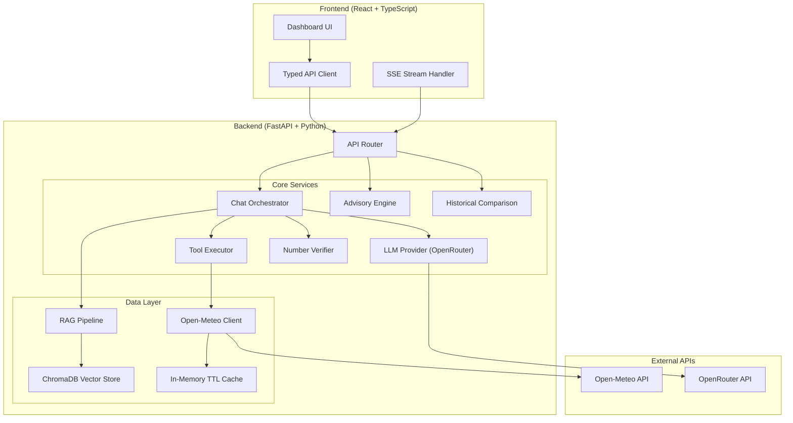
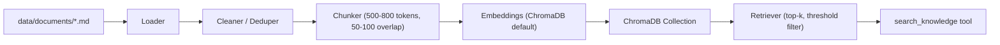
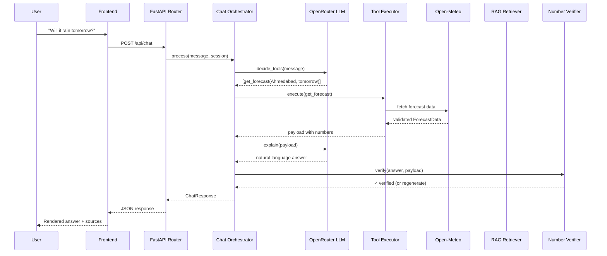
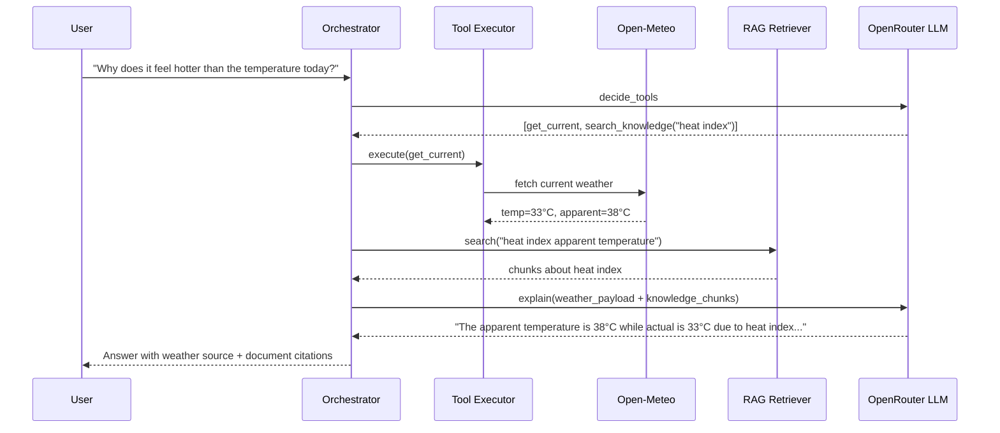
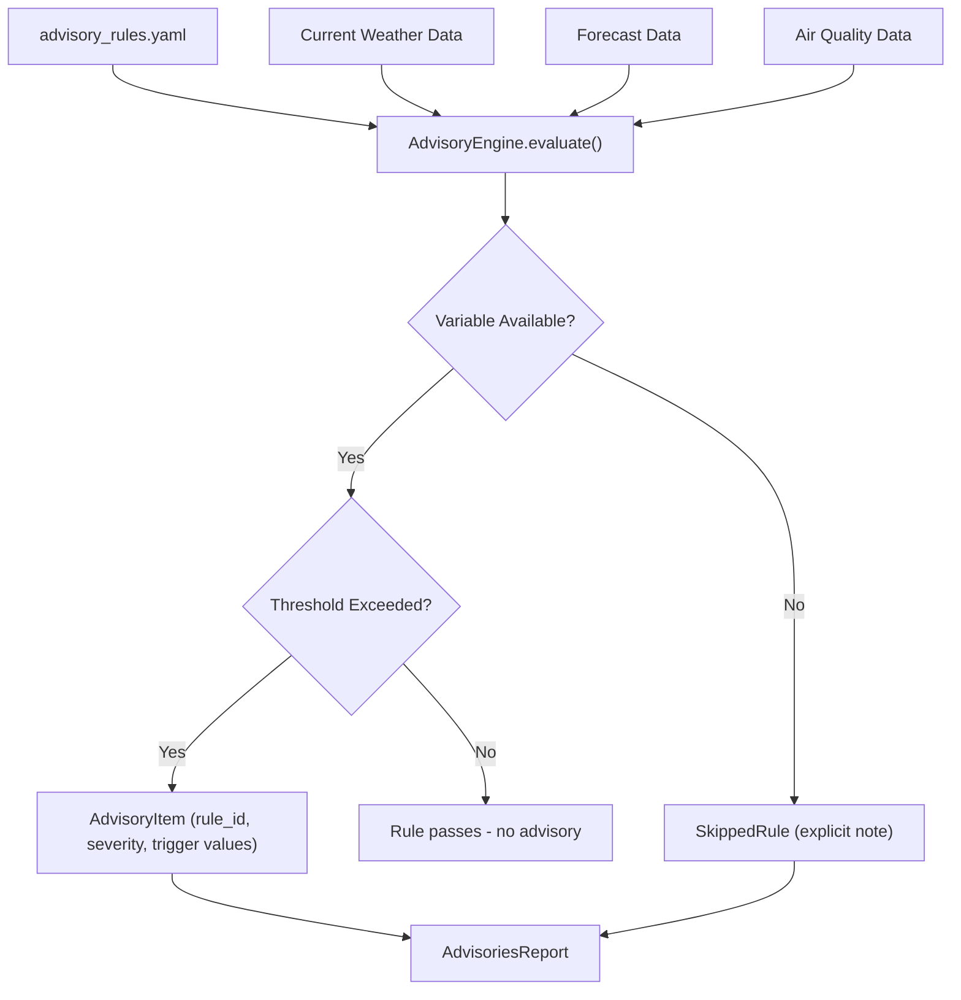
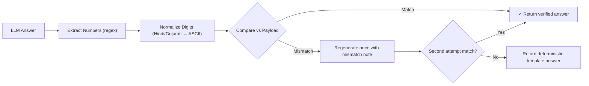
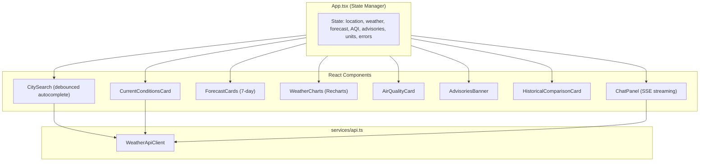
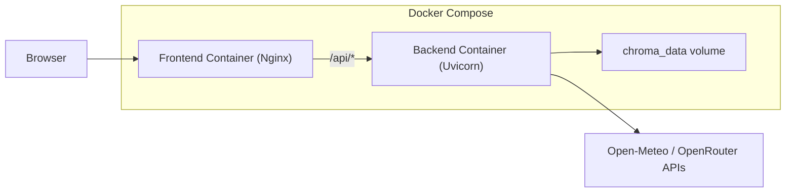

# WeatherGPT Architecture

> A meteorological intelligence platform with grounded AI chat, RAG knowledge retrieval, deterministic number verification, and rule-based advisories.

---

## 1. System Architecture Overview

---

## 2. Layer Decomposition

### 2.1 API Layer (`backend/app/api/`)

| Module | Endpoints | Purpose |
|--------|-----------|---------|
| `health.py` | `GET /api/health` | Liveness probe, subsystem status |
| `locations.py` | `GET /api/locations/search` | Geocoding with Open-Meteo |
| `weather.py` | `GET /api/weather/current`, `/forecast`, `/history` | Meteorological data endpoints |
| `air_quality.py` | `GET /api/air-quality` | AQI and pollutant concentrations |
| `chat.py` | `POST /api/chat`, `/api/chat/stream`, `/api/chat/clear` | Grounded AI conversational assistant |
| `advisories.py` | `GET /api/advisories` | Rule-based safety advisories |
| `knowledge.py` | `POST /api/knowledge/search` | RAG document retrieval |
| `historical.py` | `POST /api/historical/comparison` | Multi-year statistical comparison |
| `deps.py` | — | Dependency injection (providers, cache) |

### 2.2 Services Layer (`backend/app/services/`)

| Service | Responsibility |
|---------|---------------|
| `open_meteo.py` | Async httpx client for all Open-Meteo APIs (geocoding, current, forecast, historical, air quality) |
| `normalizers.py` | Provider JSON → Pydantic model transformations |
| `chat_orchestrator.py` | Tool-calling loop: question → LLM decides tools → execute → verify → explain |
| `llm_provider.py` | Abstract `LLMProvider` + `OpenRouterProvider` + `MockLLMProvider` |
| `tools.py` | Tool definitions with JSON schemas for LLM function calling |
| `number_verifier.py` | Deterministic number extraction and cross-validation against payload |
| `advisories.py` | YAML-driven rule engine for weather safety advisories |
| `historical_comparison.py` | Multi-year date range alignment, gap detection, deterministic computation |
| `session_store.py` | Bounded session context (last 6 turns + location) |
| `india_alerts.py` | Static IMD reference link for Indian locations |
| `providers.py` | Abstract `WeatherProvider` interface |
| `exceptions.py` | Structured exception hierarchy |

### 2.3 RAG Pipeline (`backend/app/rag/`)

- **Document corpus**: 15-30 educational meteorological documents in `data/documents/`
- **Metadata**: title, publisher, source_url, publication_date, license_notes
- **Relevance threshold**: Cosine distance ≥ 0.40 → "sufficient evidence"; below → "insufficient evidence" response
- **Security**: Retrieved text is wrapped as `[UNTRUSTED_RETRIEVED_TEXT]` — cannot modify system instructions

### 2.4 Schemas Layer (`backend/app/schemas/`)

| Schema | Models |
|--------|--------|
| `base.py` | `BaseWeatherModel` (coordinates, timezone, provider, retrieved_at, units) |
| `location.py` | `Location`, `Coordinates` |
| `weather.py` | `WeatherSnapshot`, `ForecastPoint`, `ForecastData`, `HistoricalRecord`, `AirQuality` |
| `chat.py` | `ChatRequest`, `ChatResponse`, `SourceRef` |
| `comparison.py` | `HistoricalComparisonResult`, `YearlyBreakdown` |
| `advisories.py` | `AdvisoriesReport`, `AdvisoryItem`, `SkippedRule` |
| `error.py` | `ErrorResponse` |
| `api.py` | `APIResponseEnvelope` |

### 2.5 Utilities (`backend/app/utils/`)

| Utility | Purpose |
|---------|---------|
| `cache.py` | Abstract `Cache` interface + `InMemoryTTLCache` (Redis-replaceable) |
| `date_resolver.py` | Resolves "today", "tomorrow", "this weekend" in location timezone |
| `language.py` | Language detection and digit normalization (Hindi/Gujarati) |
| `rate_limit.py` | Per-endpoint sliding window rate limiter |
| `logging.py` | Structured JSON logger with API key redaction |

---

## 3. Data Flow: Chat Question

---

## 4. Data Flow: Mixed Question (Weather + Knowledge)

---

## 5. Advisory Engine

---

## 6. Number Verification Pipeline

---

## 7. Frontend Architecture

---

## 8. Caching Strategy

| Data Type | TTL | Cache Key Pattern |
|-----------|-----|-------------------|
| Geocoding results | 1 hour | `geo:{query}:{count}` |
| Current weather | 10 minutes | `current:{lat}:{lon}:{units}` |
| Forecast | 15 minutes | `forecast:{lat}:{lon}:{days}:{units}` |
| Air quality | 10 minutes | `aqi:{lat}:{lon}` |
| Historical data | 24 hours | `history:{lat}:{lon}:{start}:{end}:{units}` |

The `Cache` interface (`utils/cache.py`) is designed for drop-in Redis replacement.

---

## 9. Security Measures

- **Secrets**: All API keys are server-side only via `pydantic-settings` / environment variables
- **Input validation**: Pydantic models validate all request parameters
- **Rate limiting**: Sliding window per IP on `/api/chat`
- **Request size limits**: Bounded message length in chat requests
- **Bounded retries**: Max 2 retries with exponential backoff on upstream calls
- **RAG quarantine**: Retrieved text wrapped as untrusted data, cannot alter system instructions
- **Log redaction**: API keys, Bearer tokens, and passwords redacted from structured JSON logs
- **Security headers**: `X-Content-Type-Options: nosniff`, `X-Frame-Options: DENY`, `Referrer-Policy: strict-origin-when-cross-origin`

---

## 10. Deployment Architecture

- **Backend**: Python 3.11-slim, pre-ingested ChromaDB, non-root user, healthcheck via `/api/health`
- **Frontend**: Multi-stage build (Node 20 → Nginx Alpine), reverse proxy to backend
- **Volume**: `chroma_data` persists the vector store across restarts
